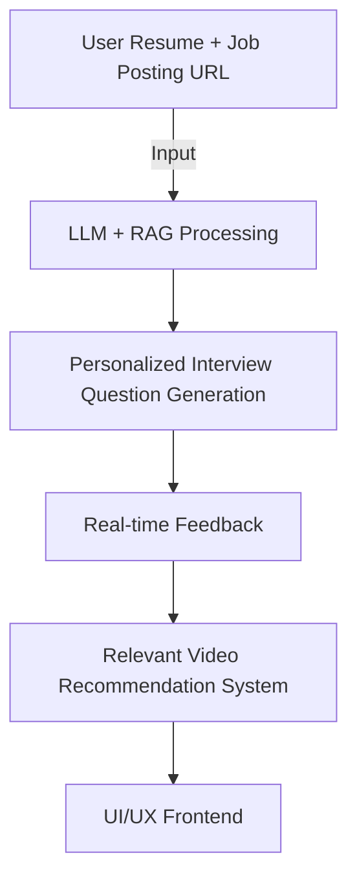

<!-- Header -->


# 👀 Jobis
An AI-powered **personalized interview preparation platform**.

Jobis generates tailored interview questions based on users' resumes and job posting URLs. It helps users prepare effectively for job interviews by providing real-time feedback and recommending relevant learning videos.

---

## 🍎 Introduction


Jobis aims to go beyond traditional recruitment and resume management services by offering a **personalized AI-powered interview preparation experience**.

Based on each user's resume and target job position, Jobis generates customized interview questions and provides actionable feedback. It also recommends relevant video resources to help users improve areas where they need additional preparation.

**Key Features**
- 📝 **Personalized Interview Question Generation** (LLM + RAG)
- 💬 **Real-time Feedback and Improvement Suggestions**
- 🎥 **Resume-based Video Recommendations**
- 📊 **Interview Feedback History Management**

---

## 🍎 Team


---

## 🍎 Background


### Limitations of Existing Services
1. Primarily focused on **recruitment rather than interview preparation**
2. Reliance on **standardized interview questions**, resulting in limited diversity and relevance
3. **Limited personalization** based on individual qualifications and job requirements
4. **Lack of real-time feedback** to support continuous improvement

➡️ Jobis addresses these limitations by providing a differentiated interview preparation solution focused on **personalization and actionable feedback**.

---

## 🍎 Tech Stack

<h4>Frontend</h4>
<div>
  &nbsp
  &nbsp
  &nbsp
  &nbsp
  &nbsp
  &nbsp
</div>

<h4>Backend</h4>
<div>
  &nbsp
  &nbsp
  &nbsp
</div>

<h4>AI</h4>
<div>
  
  
  
  
</div>

---

## 🍎 System Architecture



---

## 🍎 UI/UX


---

## 🍎 Core Features

### Video Recommendation System

* Automatically recommends relevant learning videos based on the user's resume and target job position
* Enhances personalization through **FAISS-based vector similarity search**
* Retrieves up-to-date learning resources through YouTube crawling using `yt_dlp` and `selenium`

### AI Interview Chatbot

* Simulates an interviewer by generating personalized interview questions
* Provides **real-time feedback** on user responses and suggests areas for improvement
* Stores interview responses and maintains feedback history to help users track their progress over time

---

## 🍎 Installation & Setup

```bash
# Clone repository
git clone https://github.com/your-repo/jobis.git
cd jobis

# Run Backend
cd backend
docker-compose up --build

# Run Frontend
cd frontend
npm install
npm run dev
```

---

## 🍎 Future Improvements

* Voice-based real-time feedback using **Speech-to-Text and Sentiment Analysis**
* Expansion of company-specific and job-specific interview datasets
* Enhanced **personalization based on user data and interview history**
* Interactive interview mode with realistic video interview simulations

